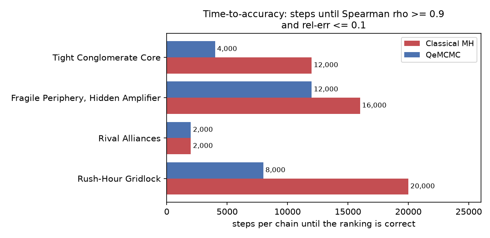

# QeMCMC showcase: bailout decisions under a fixed iteration budget

Each scenario is a named real-world situation where the network sits near a tipping point and a budget-K bailout must be chosen from the susceptibility ranking. Both samplers get the *same* iteration budget; the question is who ranks the bailout targets correctly *first*.

| scenario | QeMCMC correct from | classical MH correct from |
|---|---|---|
| Tight Conglomerate Core | 4,000 | 12,000 |
| Fragile Periphery, Hidden Amplifier | 12,000 | 16,000 |
| Rival Alliances | 2,000 | 2,000 |
| Rush-Hour Gridlock | 8,000 | 20,000 |

## Tight Conglomerate Core (`s1_conglomerate_core`)

**A tight cluster of banks that prop each other up**  Six core banks guarantee each other's debt so tightly that the system has two stable moods: everything stands, or the whole core falls together. A short simulation that only explores one mood will confidently tell you the wrong bank to bail out.

Setup: finance problem, n=12, 20,000 steps x 4 chains per arm.

### Time to correct ranking

| arm | first correct prefix | full-length relerr | full-length rho |
|---|---|---|---|
| QeMCMC | 4,000 | 0.008 | +0.958 |
| Classical MH | 12,000 | 0.018 | +0.972 |

**QeMCMC ranked the bailout targets correctly at 4,000 steps; classical Metropolis needed 12,000.** That is a 3.0x iteration-budget gap.

## Fragile Periphery, Hidden Amplifier (`s2_hidden_amplifier`)

**A mid-tier bank quietly amplifies every shock**  The dangerous bank is not the biggest one: it sits in the middle of the network and multiplies whatever hits it. Vulnerability that only shows up under stress is exactly what a frozen sampler misses.

Setup: finance problem, n=12, 20,000 steps x 4 chains per arm.

### Time to correct ranking

| arm | first correct prefix | full-length relerr | full-length rho |
|---|---|---|---|
| QeMCMC | 12,000 | 0.055 | +0.986 |
| Classical MH | 16,000 | 0.075 | +0.916 |

**QeMCMC ranked the bailout targets correctly at 12,000 steps; classical Metropolis needed 16,000.** That is a 1.3x iteration-budget gap.

Both samplers chose the **same bailout sets at every budget** -- here the quantum advantage is in how *fast* the ranking became trustworthy, not in a different final decision.

## Rival Alliances (`s3_rival_alliances`)

**Two alliances whose guarantees cancel each other out**  Frustrated loops of guarantees mean no arrangement pleases everyone -- the energy landscape is rugged for every method. Both samplers rank correctly from the shortest prefix here.

Setup: finance problem, n=12, frustration=0.50, 20,000 steps x 4 chains per arm.

### Time to correct ranking

| arm | first correct prefix | full-length relerr | full-length rho |
|---|---|---|---|
| QeMCMC | 2,000 | 0.020 | +1.000 |
| Classical MH | 2,000 | 0.039 | +1.000 |

**No time-to-accuracy gap here** -- both samplers rank correctly from the shortest prefix.

Both samplers chose the **same bailout sets at every budget** -- here the quantum advantage is in how *fast* the ranking became trustworthy, not in a different final decision.

## Rush-Hour Gridlock (`s4_rush_hour`)

**A city grid at rush hour, one closure from gridlock**  Closing the wrong street at the wrong hour doesn't just slow one block -- traffic reroutes and jams somewhere else. The worst street is only visible once you've seen both the free-flowing and the gridlocked regime.

Setup: traffic problem, n=3, 20,000 steps x 4 chains per arm.

### Time to correct ranking

| arm | first correct prefix | full-length relerr | full-length rho |
|---|---|---|---|
| QeMCMC | 8,000 | 0.048 | +1.000 |
| Classical MH | 20,000 | 0.067 | +0.967 |

**QeMCMC ranked the bailout targets correctly at 8,000 steps; classical Metropolis needed 20,000.** That is a 2.5x iteration-budget gap.

Both samplers chose the **same bailout sets at every budget** -- here the quantum advantage is in how *fast* the ranking became trustworthy, not in a different final decision.
